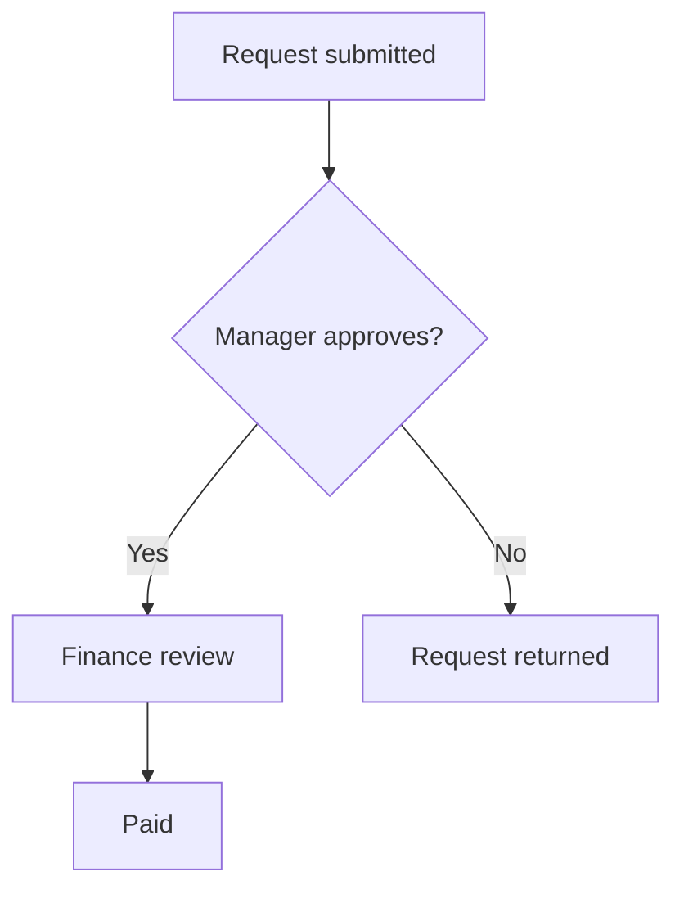

# Turn steps or Mermaid into an editable flowchart

Slatebox draws flowcharts as real notes and lines that people can move, restyle and reconnect.

## Choose the tool

- **The person pasted Mermaid** (`graph TD`, `flowchart LR`, or a Markdown block with a mermaid fence): call `import_mermaid` with that text as `mermaid`. Do not rewrite it unless the call reports a mistake.
- **A simple chain of steps** with no branches (for example "request, manager review, finance approval, paid"): call `create_slate` with `kind: "diagram"` and a `brief` that joins the steps with `->`, such as `Request -> Manager review -> Finance approval -> Paid`. The brief holds up to 1200 characters.
- **Steps with decisions, loops or parallel paths**: write a Mermaid flowchart yourself and call `import_mermaid`.

## Writing the Mermaid

- Use `TD` (top to bottom) for most processes and `LR` (left to right) for timelines or pipelines.
- Use `[text]` for steps and `{text}` for decisions. Label decision branches (`-- Yes -->`).
- Put groups of steps in a `subgraph`. Slatebox draws each subgraph as a frame.
- Keep each note to a few words.

## Call details

- `import_mermaid`: pass `mermaid` and a short `name`. Leave out `shareId` for a new slate, or pass a slate's `shareId` to draw beside what it holds.
- On `400 mermaid_invalid`, fix the named line and call once more. On `422 mermaid_unsupported`, the diagram type is not a flowchart, mind map or Gantt chart: say so and offer a flowchart version.
- On `confirmation_required`, show the person the reasons and repeat the call with `confirm` and the same `idempotencyKey` only if they agree.

## Finish

Say in one sentence what the flowchart shows (the start, the main decision, the end). End with the slate link from the result, for example `https://app.slatebox.com/canvas/<shareId>`.
